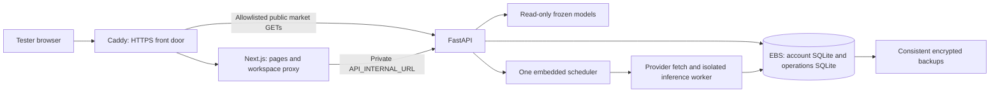

# AWS staging readiness audit — 2026-10-14

> **Implementation follow-up (2026-10-14):** The source/configuration blockers below have been addressed. Current versions, architecture, exact checks and remaining release gates are recorded in [the EC2 runbook](aws-ec2-staging.md) and [verification report](aws-staging-verification.md). The original audit below describes the pre-implementation working tree. Readiness remains **NOT READY** until real Docker image builds/start/recreation are verified on a host with an available daemon. No AWS deployment, commit or push occurred.

**Verdict: the application is a good fit for one persistent AWS VM, but it is not ready for a complete public staging deployment unchanged.** Keep the existing operations architecture and SQLite for a private pilot. Fix browser API routing, runtime support, release/artifact delivery and deployment configuration before opening the site to testers. No AWS resources were provisioned, no deployment or database migration was performed, and no application/model code was modified. Nothing was committed or pushed.

Inspected the current working tree on `wip/data-automation`, checkpoint `21b1852`, including the uncommitted automation/localization changes and new Dockerfiles. A clone of that checkpoint alone does **not** contain all reviewed changes.

## 1. Current architecture

| Component | Actual implementation |
| --- | --- |
| Frontend | Next.js App Router, locked Next 14.2.35, React/React DOM 18.3.1, TypeScript 5.9.3. `npm ci`, `npm run build`, `npm start`; Docker start includes `--hostname 0.0.0.0`; port 3000. It needs a Node server: cookies and the workspace proxy preclude an S3-only static deployment. |
| Backend | FastAPI/Uvicorn. `uvicorn src.api.main:app --host 0.0.0.0 --port 8000`; currently one default worker. Docker uses Python 3.11-slim; the verified local environment uses Python 3.14. |
| Containers | `docker-compose.yml`: API and frontend, both `restart: unless-stopped`; API mounts `./data:/app/data` and `./models:/app/models`; ports 8000 and 3000 are published on the host. No reverse proxy, TLS service, healthcheck, readiness dependency or host boot/mount unit is defined. |
| Account database | SQLite, WAL, default `data/paper/workspace.sqlite3` (in container `/app/data/paper/workspace.sqlite3`). Override: `PAPER_DB_PATH`. |
| Users and admins | Same `users` table, with role `user` or `admin`; independent salted scrypt password hashes. Admins are not a separate database. Optional environment bootstrap; preferred secure interactive CLI `python -m src.admin.create_admin`. |
| Account state | `sessions`, `portfolios`, `positions`, `quotes`, `orders`, portfolio `snapshots`, `login_attempts`, `admin_activity` in the account database. Sessions store HMAC digests, not raw browser tokens. Admin audit is append-only through database guards. |
| Market operations | Separate SQLite WAL database `/app/data/operations/refresh.sqlite3`; override root `MARKET_OPERATIONS_DIR`. Tables: `jobs`, `attempts`, validated `snapshots`, `current_snapshots`, `scheduler`, `alerts`. Immutable per-job files in `data/operations/staging/<job_id>`. |
| Current market APIs | `/api/latest`, `/api/korea/latest` serve committed snapshot payloads with freshness metadata. Missing validated snapshot returns 503. |
| Workspace APIs | Browser uses same-origin `/api/workspace/*` through Next.js. Next server forwards to server-only `API_INTERNAL_URL`, currently `http://api:8000` in Compose. Auth/admin/paper routes remain protected in FastAPI. |
| Browser market API | Five source locations read `NEXT_PUBLIC_API_URL` and otherwise use `http://127.0.0.1:8000`. These requests originate in the visitor's browser, not the frontend container. |
| Scheduler | API lifespan starts a daemon polling thread when `MARKET_REFRESH_ENABLED=true`. Startup and each poll evaluate due sessions/catch-up; U.S./Korea run sequentially in this thread. Standalone operations scheduler also exists. |
| Frozen inference | Existing U.S./Korea joblib Pipeline artifacts, 17 inputs each. Staged worker uses existing calculations and inference, verifies feature names/order/finite outputs and model checksum before atomic publish; no training. |
| Providers | Yahoo Finance/yfinance: SPY/VIX and paper daily-close quotes; FRED graph CSV: DBAA/DGS10; KRX: KOSPI200/VKOSPI; BOK ECOS: corporate/government 3Y yields. AWS needs outbound HTTPS and provider access from its egress address. |
| Future products | Free/Pro entitlements, Portfolio Outlook and AI Risk Advisor are not implemented. They do not require extra infrastructure for this staging audit. Plan PostgreSQL/managed services when those workflows and public load are defined. |

Existing deployment files: `Dockerfile.api`, `frontend/Dockerfile`, `docker-compose.yml`, `.dockerignore`, `frontend/.dockerignore`, `.env.example`. No AWS infrastructure template, TLS proxy, backup/restore tooling or automated release workflow is present.

Refresh commands (inside the future API container):

```text
python -m src.operations refresh --market both
python -m src.operations health --market both
python -m src.operations history --market both
python -m src.operations schedule --once
python -m src.operations schedule
python -m src.operations adopt-local --market both
```

`adopt-local` is an explicit bootstrap option using real historical data and frozen models; it marks retrieval provenance unknown and never certifies CURRENT. Never run `run_pipeline.py` during deployment: it retrains.

Health endpoints:

- `/health`: basic process liveness only; its static `ok` response does not verify storage, artifacts or provider freshness.
- `/api/data-health`: market source status, Last Known Good, job and scheduler health; HTTP 200 can contain DELAYED/STALE/PARTIAL/ERROR.
- `/api/admin/data-health`: protected operational history/attempts/outbox summaries.
- `/api/admin/overview`: protected account/database availability and aggregate counts.

## 2. Persistence audit

A restart does not inherently erase a correctly mounted EBS-backed directory. Recreating a container loses its writable layer; terminating a VM can delete its EBS volumes unless their deletion policy is explicitly disabled. A persisted volume is still not a backup. [AWS EBS persistence](https://docs.aws.amazon.com/ebs/latest/userguide/EBSFeatures.html), [termination settings](https://docs.aws.amazon.com/AWSEC2/latest/UserGuide/preserving-volumes-on-termination.html).

| State | Classification | Required handling |
| --- | --- | --- |
| Account SQLite: users/admin roles/password hashes | PERSISTENT REQUIRED | Encrypted local EBS, restricted file permissions, consistent backups. |
| Portfolios/positions/orders/realized P&L/valuation history | PERSISTENT REQUIRED | Same account database; never initialize a replacement DB during a redeploy. |
| Admin activity log | PERSISTENT REQUIRED | Same DB; retain audit history. |
| Server session digests | PERSISTENT REQUIRED for continuity | Same DB and unchanged `PAPER_SESSION_SECRET`. Secret regeneration at every boot invalidates sessions despite retaining the DB. Browser cookies remain client-side. |
| Market snapshots/current pointers | PERSISTENT REQUIRED | Operations SQLite plus integrity verification; preserve original observation dates and scores across failures. |
| Job/attempt reports, scheduler history, alert outbox | PERSISTENT REQUIRED | Operations SQLite. Outbox delivery is not implemented. |
| Current published job's source history/staged artifact directory | PERSISTENT REQUIRED | Next incremental refresh reads `source_history.csv` through the committed artifact reference. Preserve together with DB backups. |
| Frozen deployment models | PERSISTENT REQUIRED | Approved copies, checksum manifest, read-only model mount. They cannot be regenerated without retraining, which is prohibited. |
| Korean historical seeds and cached targets | PERSISTENT REQUIRED for present pipeline | Must be delivered separately; see artifact list below. |
| Historical OOS metrics/CSV/SHAP research artifacts | REGENERABLE in principle; deliver existing validated copies | Public historical/validation endpoints depend on these. Do not regenerate research or retrain as part of deployment. |
| Old successful stage files | PERSISTENT REQUIRED during audit retention | Move old versions to encrypted backup/cold storage if pruning; preserve reproducibility and current references. No automatic retention policy exists. |
| Failed/unpublished stage intermediates | TEMPORARY | Prune only after a reviewed age/retention rule and ensuring no current pointer depends on them. |
| Next `.next` build and `node_modules` | REGENERABLE | Build from approved source/lockfile; do not treat caches as user state. |
| Python bytecode, API caches, loaded model objects | REGENERABLE | Recreated on startup. |
| Per-market lock ownership | TEMPORARY | OS releases locks on exit. Lock path must remain on the shared local persistent operations filesystem. |
| Expiring paper quotes/login throttling windows | TEMPORARY logically | Stored in durable account DB today; expiry/throttling may reset without losing orders, but do not delete the entire DB. |
| Client `sessionStorage` pending orders | TEMPORARY client-side | Server orders/idempotency remain durable; client storage is not a server backup. |
| Future proxy TLS keys/certificates | PERSISTENT REQUIRED once configured | Persist proxy certificate storage on EBS and restrict backup access. |
| Docker/app logs | TEMPORARY with bounded operational retention | Rotate; preserve useful errors separately. Default unbounded logs can consume disk. |

Measured current file sizes: data approximately **102.3 MiB**, operations **82.3 MiB**, model files combined **0.37 MiB**, account database **84 KiB**, frontend `.next` build **160.6 MiB**. Both SQLite files passed read-only `PRAGMA quick_check`. These are local measurements, not growth forecasts.

**Portability issue:** both current committed snapshot payloads store absolute staging paths under this development machine. They are not `/app/data/...` paths. Editing the payload path directly also breaks its snapshot SHA256 integrity check. For fresh private staging, initialize a separate operations database and publish validated snapshots inside `/app`, using approved historical seeds. If retaining the existing ledger is required, implement a validated relocation/import procedure first; do not silently transplant or edit its pointers.

## 3. Recommended AWS architecture

**One EC2 instance + Docker Compose + encrypted EBS; keep SQLite for a private pilot.** Example initial region: Seoul `ap-northeast-2`, subject to account/service/type availability. Use x86_64 initially to reduce untested container/native-wheel differences.



| Choice | Assessment |
| --- | --- |
| **EC2 + Compose — recommended** | Matches current Linux locks/local SQLite; supports instance-role credentials, SSM access, persistent EBS and explicit backup controls. No database migration or distributed scheduling is needed for private staging. |
| **Lightsail + Compose — reasonable alternative** | Same application fit and simpler predictable billing. Official IPv4 Linux bundles list **2 vCPU/2 GB/60 GB at $12/month**, or **2 vCPU/4 GB/80 GB at $24/month**, before extra snapshots/other charges. Confirm account eligibility and secret/backup access setup first. [AWS bundle table](https://docs.aws.amazon.com/lightsail/latest/userguide/amazon-lightsail-bundles.html). |
| ECS/Fargate/App Runner/Lambda/EKS | Adds storage, locks, scheduler and deployment changes for this file-based architecture; no compelling staging benefit. Do not place WAL SQLite on network filesystems to simulate a distributed DB. Static-only frontend hosting cannot run the workspace proxy. |

Compute: begin with **t3.small, 2 vCPU/2 GiB**, a few private testers and builds separated from serving/refresh. AWS currently lists t3.small among newer-account Free Tier eligible types, but account eligibility, available credits and expiry were **not** inspected. Do not assume t3.medium/t3a.medium or Lightsail is available under the user's specific Free plan. If measured runtime or build peaks require 4 GiB, select an account-approved x86_64 option in the chosen region rather than silently changing account plans. [EC2 eligibility](https://docs.aws.amazon.com/AWSEC2/latest/UserGuide/ec2-free-tier-usage.html).

Storage: 30 GiB root EBS for OS/images/build overhead, plus a separate encrypted 20 GiB gp3 data volume initially. Set data volume `DeleteOnTermination=false`, mount at `/srv/market-stress`, and keep stable container paths `/app/data` and `/app/models`. Prefer models mounted read-only. Set a disk alarm and a timeboxed staging retention policy; recurring delayed-source retries can create many history copies.

Networking: one public subnet with internet gateway for provider/management HTTPS access; no NAT gateway, load balancer or Kubernetes. Keep API 8000 and frontend 3000 on the Compose network, not internet-published. Publish only the proxy front door; restrict private-staging access to testers, use SSM or tightly restricted SSH, and preserve original Host/Origin through the proxy.

Restart: enable Docker at boot; a host service must require the EBS mount before starting Compose. Retain `unless-stopped`, add liveness checks/startup health dependency, rotate logs and allow a considered shutdown interval. A missing volume must fail startup rather than create a fresh empty directory/DB on the root disk. Docker healthcheck failure alone does not implement automatic container restart; use restart policy for exits plus host/external monitoring for unhealthy services.

Secrets: backend-only runtime variables, initially a root-owned 0600 environment file outside the repo populated securely, or an instance-role bootstrap from standard Parameter Store SecureString. The application reads environment variables and needs no model/API redesign. SecureString is encrypted and standard tier is listed as free; AWS recommends Secrets Manager when credential rotation/purpose-built controls are needed. Confirm service access under the account plan. [AWS configuration storage](https://docs.aws.amazon.com/systems-manager/latest/userguide/systems-manager-parameter-store.html). No long-lived AWS keys should be embedded in either container.

Backups: daily SQLite online backups, immutable referenced artifacts and approved model manifest to private encrypted S3; 7 daily and 4 weekly copies as an initial policy, adjusted after measuring costs/growth. Also take EBS snapshots before upgrades. The backup must reference artifact directories from the **backed-up operations database**, not a later live pointer. Never copy just an active `.sqlite3` file while ignoring WAL. Test a restore onto separate storage. [SQLite online backup](https://www.sqlite.org/backup.html).

Costs: EC2 compute, EBS, snapshots/S3, public IPv4, CPU surplus credits where applicable, egress and optional monitoring are separate charges. Quote the selected region/type in AWS before launch; no exact account bill or zero-cost guarantee is established. Lightsail's bundle prices above provide a useful low-cost alternative benchmark. Credits reduce eligible charges but are not a permanent operating budget. Set a budget/credit-expiry reminder. [EC2 pricing](https://aws.amazon.com/ec2/pricing/on-demand/), [IPv4 pricing](https://aws.amazon.com/vpc/pricing/), [Free plan rules](https://aws.amazon.com/free/free-tier-faqs/).

## 4. Resource requirements

| Resource | Initial estimate | Evidence/limit |
| --- | --- | --- |
| CPU | 2 vCPU, CPU-only | Two small XGBoost pipelines; background refresh is sequential by market. No GPU or model training is required. |
| RAM | 2 GiB private pilot minimum target; 4 GiB if building on-host or peak measurements require it | Local API import plus loading both pipelines peaked at **189,164 KiB (~185 MiB)** and completed in ~2 seconds. This is **not** a complete refresh, concurrency or Docker load benchmark. Add Node, one worker, HTTP dataframes, OS, password hashing and peak buffers. Avoid a 512 MiB/1 GiB micro as the default. |
| Disk | 30 GiB root + 20 GiB data initially | Actual app state is ~102 MiB; most initial disk use will be images/dependencies/build caches. Operations staging grows without bound today. |
| Build | Separate/sequential build, no simultaneous refresh/load on 2 GiB | Use an approved AWS/CI build runner or stop application activity while building privately. Measure peak RAM in the actual images before widening staging. |

Keep the Docker Python/native dependencies aligned with the verified frozen artifacts. Verified local versions: pandas 3.0.6, NumPy 2.5.3, scikit-learn 1.9.1, XGBoost 3.4.1, joblib 1.6.0, exchange-calendars 4.13.2, FastAPI 0.142.2. `requirements.txt` mostly uses lower bounds; Docker Python 3.11 can resolve a different compatible stack from local Python 3.14. Pin a tested deployment stack and prove frozen model loading/inference in that image. Do not retrain to solve dependency differences.

## 5. Database recommendation

**Retain SQLite for initial private single-host staging; do not migrate in this task.** WAL and immediate transactions already support concurrent readers and serialized writes, paper-order idempotency and atomic market publication. Persistent EBS and tested backups are sufficient for a small pilot.

SQLite can also serve some real multi-user single-server applications; user count alone does not make it unsuitable. The constraints are write contention, availability/recovery and topology. For the planned paid public service, entitlements, richer portfolio workflows or multiple API hosts, plan **PostgreSQL before that production expansion**. Migrate both account state and the operational ledger and replace filesystem-only locks if scheduling spans hosts. A SQLite-to-PostgreSQL transition needs schema/transaction/trigger/locking changes; it is not simply a connection URL switch. Managed RDS is unnecessary cost/complexity for this staging pilot. [SQLite concurrency/topology guidance](https://www.sqlite.org/whentouse.html).

## 6. Scheduler deployment

Use the existing **one API process with embedded scheduler** first. Enable `MARKET_REFRESH_ENABLED=true` only after artifacts/configuration and controlled first refresh succeed. No VS Code/browser/laptop loop is involved: AWS Docker runs Uvicorn, lifespan starts the thread, and boot startup restarts the service.

Current guarantees in code:

1. Providers fetch each required series independently with HTTP timeouts and at most three attempts per request; transient backoff 1/2 seconds, permanent validation errors stop retries.
2. Complete real historical inputs are staged in a per-job directory. At least 400 common observations are needed; no current observation is manufactured to advance dates.
3. Existing cleaner/features/MSI/threshold calculations run in a separate worker with redirected staging paths, then frozen model inference and final finite/feature/order/model-hash checks.
4. One SQLite transaction writes the valid snapshot, changes the market pointer and completes the job/report. Failure preserves Last Known Good.
5. Per-market `fcntl.flock` serializes API scheduler/manual CLI collisions on this host. Duplicate content reuses publication; interrupted jobs recover under the next lock acquisition.
6. Poll every 60 seconds. Due sessions use exchange holidays/early closes; U.S. close+12h and Korea close+6h. Normal deadlines: **U.S. 17:00 KST in EDT / 18:00 KST in EST**, **Korea 21:30 KST**. UTC-aware calculations handle DST; keep host time synchronized.
7. Startup/poll compares expected sessions, source coverage and durable jobs; missed execution catches up, failed/delayed attempts retry after 30 minutes. Scheduler-run status and heartbeat age are distinct from data freshness. A failed latest job retries even with a current retained snapshot.
8. DGS10 has independent Board-holiday expectation; Moody's publication expectation remains conservative operational policy.

Do not also start a standalone loop or host cron for normal refresh when embedded scheduling is enabled. The existing standalone CLI is an alternative for later isolation, with API scheduling disabled and the same local volumes/locks.

Limits: startup catch-up can be deferred by the existing 30-minute recent-attempt throttle; an interrupted RUNNING job is marked ERROR when the next worker actually obtains its lock, not necessarily immediately at API boot. The in-process daemon thread is not an external supervisor; `/health` alone will miss a stopped scheduler. Add EC2 status monitoring and heartbeat/freshness checks. Shutdown can interrupt an in-flight job; atomic publication protects the pointer and recovery marks the interrupted job. KRX gaps exceeding the bounded 90-day window need explicit historical backfill. Alert delivery, staging retention and production provider SLAs remain operational follow-ups.

## 7. Frozen models and artifact delivery

Both required deployment files exist, load locally as 17-feature Pipelines, and remained unchanged during the audit:

| Market | Path | Bytes | SHA256 |
| --- | --- | --- | --- |
| U.S. | `models/saved/xgboost_latest.joblib` | 129174 | `90c51c245ebe62b58f804098a7a7045b60fb64ef83da72d4c9a049cf8d5eeb0d` |
| Korea | `models/korea/xgboost_10d_latest.joblib` | 126553 | `42c3026386a58b25df337a431fbd5a793e93665a3d9a3f2cf22be4cfcc9186e3` |

The worker hashes the model before and after calculation/inference, validates 17-column count/order and stores `model_sha256`. Store snapshot SHA256 validates payload integrity. Add release-manifest verification at provisioning/startup: the current worker check proves no **during-inference** change, not independent approval of whatever file was already on disk.

These models are actually tracked in the current Git index despite ignore patterns. Both Dockerfiles omit models/data from the image; they must be present on the bind mount. Deliver only trusted approved artifacts, and mount models read-only.

Mandatory runtime/seed bundle, already present locally:

- `data/raw/raw_market_data.csv` — U.S. bootstrap seed; `refresh()` calls `seeds()` before even the full provider retrieval.
- `data/raw/korea/krx_indices.csv`, `vkospi.csv`, `ecos_credit.csv` — Korea bootstrap/history; KRX only refreshes a bounded revision window.
- `data/processed/korea/korea_targets.csv` — **required** by the existing Korea feature builder, which reads it even during isolated operational calculation. Do not regenerate it through training.
- Existing `data/processed`, `data/processed/korea` and `data/features` validated research artifacts — OOS history, multi-horizon/model metrics, MSI and SHAP endpoints require their files. Missing files give API errors/empty UI sections, not newly generated validation results.
- Both frozen models above, approved manifest and any existing benchmark artifacts needed for preserving the research bundle.

Korea seed/processed data and SHAP files are **not tracked**; a fresh clone is insufficient. Current Dockerfiles/ignore files and many reviewed changes are also uncommitted/untracked. Future deployment must use a reviewed release bundle/patch manifest containing the current approved work, or an eventual separately authorized reviewed commit. Exclude `.env`, account databases, unrelated backups and experimental scripts from the source bundle. Transfer validated data separately and do not include existing personal accounts in private staging by default.

## 8. Secrets/security findings

Inspection did not print credential values. Checks found:

- Root `.env` is ignored and not tracked. Git index contains `.env.example`, not real `.env` files.
- 308 local Git blob objects (~19.3 MB) were scanned for the currently configured secret values and common AWS-key/private-key/literal ECOS-key URL signatures; **no matches**. This covers available local Git objects, not un-fetched remote history or every possible credential format.
- Existing `.next` JS/JSON/HTML artifacts contain **no configured secret values** in the scan. `NEXT_PUBLIC_API_URL` is the only browser-public environment reference; `API_INTERNAL_URL` remains server-only. Root environment files are omitted from the API image; frontend Docker context excludes `.env*`.
- **Prevention gap:** `.env.local` and `.env.staging` are not ignored by the root Git rules. Broaden ignore patterns while retaining sample files before introducing deployment env variants. Broaden root Docker ignore rules and exclude experimental/private configuration directories too.
- KRX/ECOS/session secret are configured locally; FRED API key and environment admin bootstrap credentials are unset. Values were not displayed or copied. FRED operational refresh uses public graph CSV and does not require that legacy key. Unset admin bootstrap variables do not mean stored admin accounts are absent.
- Defaults are development-oriented: cookies not Secure and allowed origins localhost; `APP_ENV`/`PORT` do not automatically configure these controls or override the hardcoded Uvicorn port.
- API CORS is currently wildcard with credentials. Keep backend private and market proxy allowlisted; review exact-origin/no-cross-origin policy before broader exposure.
- Both images currently run as root and the model mount is writable. Set model read-only at minimum; non-root runtime and mount permissions should be part of deployment hardening.
- Existing authentication has salted scrypt hashes, seven-day HttpOnly/SameSite=Lax sessions, CSRF checks, server-side ownership/role checks and read-only admin. It lacks email verification, password reset/MFA and distributed/client-aware throttling. Current IP throttling aggregates users behind the Next proxy. Private test accounts are appropriate; public-account hardening is a separate task before public production.
- Current Next 14 is unsupported under the official support policy; Docker Node 20 is EOL. Treat supported runtime/framework upgrades as a prerequisite for internet-facing staging, even though the current local build passed. No particular unverified CVE is asserted. [Next support policy](https://nextjs.org/support-policy), [Node release status](https://nodejs.org/en/about/previous-releases).

Required configuration inventory (names only; no credentials):

| Variable | Scope/need |
| --- | --- |
| `KRX_API_KEY`, `ECOS_API_KEY` | Backend required for real Korea refresh; currently absent from `.env.example`. |
| `FRED_API_KEY` | Backend optional for existing legacy FRED tooling; public operational CSV adapter does not use it. |
| `PAPER_SESSION_SECRET` | Backend required for auth, stable random value at least 32 characters; persists across restarts. |
| `PAPER_DB_PATH` | Backend; use `/app/data/paper/workspace.sqlite3`. Existing Compose does not forward this override. |
| `MARKET_OPERATIONS_DIR` | Backend; use `/app/data/operations`. Existing Compose does not forward this override. |
| `MARKET_REFRESH_ENABLED` | Backend; false during bootstrap/review, then true for exactly one scheduler. Compose currently defaults true. |
| `PAPER_ALLOWED_ORIGINS` | Backend exact staging browser origin, including scheme/port when applicable. |
| `PAPER_COOKIE_SECURE` | Backend true for public HTTPS. False only for a controlled encrypted localhost tunnel when browser origin is HTTP localhost. |
| `PAPER_STARTING_USD`, `PAPER_STARTING_KRW` | Optional simulation starting balances; existing Compose does not forward overrides. Do not change balances of existing accounts. |
| `PAPER_MAX_PRICE_AGE_DAYS` | Optional paper quote policy, separate from market-risk freshness; existing Compose does not forward it. |
| `ADMIN_EMAIL`, `ADMIN_PASSWORD`, `ADMIN_BOOTSTRAP_PROMOTE_EXISTING` | Optional legacy bootstrap; prefer secure interactive CLI, no persistent bootstrap password. |
| `API_INTERNAL_URL` | Frontend server-only runtime value `http://api:8000`. |
| `NEXT_PUBLIC_API_URL` | **Frontend build-time public nonsecret**. Proposed relative prefix `/market-api`; current build cannot receive it. |
| `APP_ENV`, `PORT` | Present in sample but not deployment switches for the inspected application entry points. |

Do not paste resolved `docker compose config`, container environment dumps or SSM/secret output into logs/reports; validate configuration with output suppressed/`--quiet`. Provider credentials must remain outside browser bundles, source releases and user responses.

## 9. Browser routing and HTTPS

**Confirmed blocker:** `frontend/Dockerfile` runs `npm run build` without a public API build argument/environment. Compose sets `NEXT_PUBLIC_API_URL=http://api:8000` only after image build. Next inlines public variables during build; the browser cannot resolve Docker service DNS even if that value were compiled. The existing local browser build contains the localhost fallback in five chunks. [Next environment/self-hosting rules](https://nextjs.org/docs/app/guides/self-hosting).

Minimal planned resolution:

1. Supply a nonsecret `NEXT_PUBLIC_API_URL=/market-api` during frontend image build.
2. Proxy `/market-api/api/...` to FastAPI `/api/...`, stripping `/market-api`, and allowlist public **GET** market routes: latest, historical, validation, multi-horizon-validation, SHAP and data-health, including Korea variants. Permit an explicitly chosen liveness route for monitoring.
3. Send `/api/workspace/*` and page/static routes to **Next**, retaining its existing auth/admin/paper proxy. Do not catch every `/api/*` and bypass this route.
4. Keep `API_INTERNAL_URL=http://api:8000` server-side. Preserve original Host and Origin or workspace POST checks return 403.
5. Add the proxy/TLS configuration and close raw 3000/8000 host publication. No UI/API route redesign is required for this prefix approach.

For an initial server smoke test with no controlled domain, use encrypted SSH/SSM port forwarding to a host-loopback proxy, with an exact localhost origin. This proves the AWS service runs independently of the development computer; it is not a completed shared HTTPS staging front door. Avoid internet HTTP credentials or trusting a self-signed IP certificate as a public deployment.

Simplest shared staging TLS: an existing controlled hostname pointing to a stable AWS IP, with Caddy ACME renewal and persistent certificate storage. Domain purchase/configuration was not performed. Restrict testers while ensuring ACME challenges can reach the required port, or use DNS validation. An AWS-generated instance hostname/IP alone is not an already-configured trusted HTTPS service. If a shared AWS-provided HTTPS hostname is essential before owning a domain, a managed CloudFront front door is an alternative, but it adds origin security, Host forwarding and no-cache/auth configuration; it is not the first-choice minimal topology. [Caddy HTTPS](https://caddyserver.com/docs/automatic-https), [SSM port forwarding](https://docs.aws.amazon.com/systems-manager/latest/userguide/session-manager-working-with-sessions-start.html).

## 10. Precise future deployment sequence

These steps are a plan, not executed commands. After prerequisite implementation creates the reviewed staging configuration, run commands from the delivered repository root. The following helper makes the file/env selection explicit and does not print secret values:

```bash
stage_compose() {
  docker compose --env-file /etc/market-stress/staging.env -f deploy/docker-compose.staging.yml "$@"
}
```

Neither the staging Compose file nor the protected AWS env file has been created by this audit.

1. **Finish deployment prerequisites in a separate implementation task.** Fix build-time API prefix/proxy, broaden secret ignores, supported Node/Next stack and compatibility changes, pin/prove frozen backend dependencies, define mounts/health/boot/backup configuration. Rerun existing frontend, Paper/Admin and operations tests without retraining. Next 16 removes synchronous cookies/route params, so specifically review `frontend/src/app/layout.tsx` and the workspace route. [Next migration guide](https://nextjs.org/docs/app/guides/upgrading/version-16).
2. **Confirm the account/budget.** Check Free/Paid plan, eligible region/types/services, credit balance/expiry and spending controls. Select one approved x86_64 EC2 instance, initially 2 vCPU/2 GiB. Do not infer permission to change account plan. No AWS account was queried in this audit.
3. **Prepare storage/network.** Encrypted root/data EBS; data deletion-on-termination disabled; `/srv/market-stress` mounted at boot. Create isolated staging data/model directories, least-privilege instance role, tester network restrictions, management access and provider HTTPS egress. Add mount prerequisite and disk/log limits.
4. **Deliver the reviewed release and artifacts.** Clone the base branch only if useful, then apply the approved uncommitted release bundle/patch and verify its manifest. Deliver frozen models and the approved raw/processed/features bundle separately. Verify the two model hashes above. Initialize fresh staging account/operations storage, or use an expressly reviewed consistent restore/import if existing records must be retained.
5. **Supply configuration securely.** Protected host env file or instance-role secret bootstrap. Set storage paths, stable staging session secret, KRX/ECOS keys, exact browser origin and correct cookie mode. Start with scheduling false; leave legacy admin/password bootstrap blank if using CLI. Ensure Compose actually forwards all intended backend overrides.
6. **Build and prove images.** Build frontend with `stage_compose build --build-arg NEXT_PUBLIC_API_URL=/market-api frontend`; build the tested API with `stage_compose build api`. The new Dockerfile/config must accept that argument first. Check model loading/17-feature contracts inside that image. Scan frontend artifacts for private values, validate image/dependency security, and confirm model mount is read-only. Docker image builds could not be verified here because Docker Desktop WSL integration is unavailable.
7. **Start server services, scheduler still disabled.** Run `stage_compose config --quiet`, then `stage_compose up -d` for the reviewed API/frontend/proxy configuration. Schema initialization is idempotent through the existing SQLite helpers; no PostgreSQL migration is needed. Confirm mount locations and `/health`. Missing initial snapshots must fail closed with 503 until validated data are published.
8. **Create staging admin and test account safely.** `stage_compose exec -it api python -m src.admin.create_admin` uses hidden interactive password input. Verify normal-user admin requests return 403 and anonymous requests 401. Exercise login, CSRF and both-currency test portfolios; no real-money trading exists.
9. **Bootstrap/refresh both markets.** If an offline initial Last Known Good is needed, explicitly run `stage_compose exec api python -m src.operations adopt-local --market both` first; it remains noncurrent. Then `stage_compose exec api python -m src.operations refresh --market both`. Check health/history, provider access from AWS, true source dates, real common-date scores, and unchanged model hashes. A legitimate DELAYED status is acceptable; fabrication is not.
10. **Activate unattended scheduling and TLS front door.** Set scheduling true in the protected configuration and run `stage_compose up -d --force-recreate api`, retaining the same stable storage/secret. Do not start an additional loop. Finish trusted HTTPS and exact-origin/Secure-cookie configuration before shared browser acceptance. Configure status/heartbeat monitoring and the backup job; restore a backup on separate test storage.
11. **Browser and recovery acceptance.** Verify Overview/U.S./Korea/Compare/Validation/Methodology, both languages, auth/Admin/Paper and independent source dates from a separate computer. Record a synthetic test order, recreate containers, then reboot EC2; order/account history, market snapshots and session continuity must persist. In an isolated test storage/configuration inject provider failure and an interrupted refresh: pointer/score must stay Last Known Good, failed job recorded, restart catches up. Never damage the only valid snapshot or use real customer records for failure injection.
12. **Next-day unattended acceptance.** Shut down the development computer. Observe AWS refresh ledger/heartbeat around the due U.S. and Korea sessions, retry/provider-delay handling and a missed-window restart. Verify the HTTPS site from another device, independent of the academy machine. Record actual AWS CPU/RAM/disk, backup restore evidence, approved model hashes and freshness states. Only then declare staging successful.

## 11. Files needing changes before deployment

| File(s) | Planned change; none applied in this audit |
| --- | --- |
| `frontend/Dockerfile` | Supported Node LTS, build-time public API prefix; later smaller/non-root runtime image. |
| `frontend/package.json`, `package-lock.json` | Supported Next/React stack and reviewed security/dependency lock. |
| `frontend/src/app/layout.tsx`, `frontend/src/app/api/workspace/[...path]/route.ts` | Async cookie/params compatibility when upgrading to current supported Next; preserve auth/route behavior. |
| `Dockerfile.api`, `requirements.txt` or new locked deployment requirements | Reconcile Python/runtime dependencies with verified frozen model loading/inference; never retrain. |
| New `deploy/docker-compose.staging.yml` or reviewed `docker-compose.yml` | Absolute EBS-backed mounts, read-only models, private service ports, public API build args, explicit config overrides, proxy, restart/health/limits. |
| New `deploy/Caddyfile` | Same-origin market prefix allowlist, Next workspace routing, Host preservation, controlled HTTPS. |
| `.gitignore`, `.dockerignore`, `.env.example` | Protect env variants/private directories/experiments; document missing provider/path/build configuration names without values. |
| New host bootstrap/boot unit/backup-restore/monitoring scripts and runbook | Require mount, load runtime config without leaks, start Docker, back up SQLite plus referenced artifacts, monitor heartbeat/disk. |
| Optional later `src/api/main.py` | Explicit narrow CORS/readiness policy before broader exposure; no model/API redesign required for the one-origin private pilot. |
| Optional relocation tooling under `src/operations` | Only if existing development ledger must be moved. Fresh staging snapshots at stable container paths avoid this initial change. |

No existing model, feature, score threshold, financial calculation, research result, authentication design or Paper/Admin business rule needs to change merely to adopt the recommended single-host storage topology.

## 12. What is ready and what must be fixed first

**Reusable now:** application structure and locally built frontend, frozen artifacts, transactional SQLite accounts/paper history, protected read-only Admin, validated snapshot serving, refresh/retry/Last Known Good/locking/catch-up/ledger implementation. Basic API/model loading and database integrity were checked read-only in this audit. Earlier tests/build/live-refresh evidence remains in the prior review reports; no live refresh was run during this audit.

**Fix before complete shared staging:** browser API URL/proxy, supported public runtime, complete reviewed source/data delivery, Docker model/dependency smoke tests, secure env/origin/cookies, persistent mounts/boot ordering, trusted HTTPS, bounded disk/log retention and backup/restore verification. Do not open today's raw Compose ports to the internet or equate `/health=ok` with working automation.

**Not blockers for a small private pilot:** PostgreSQL migration, EKS/ECS, RDS, Free/Pro, Advisor/Portfolio Outlook, multiple replicas, notification delivery, enterprise HA. Public production still needs authentication hardening, measured concurrency/capacity, operational SLAs/monitoring and a PostgreSQL/availability decision.

Success is conditional on every acceptance item in steps 8–12: independent reachability, both markets, auth, persistent paper data, validated provider refresh, next-day automation, reboot survival, failure-preserved Last Known Good, visible truthful freshness, server-only secrets, unchanged model identity, passing production image/frontend build and a recoverable backup. Those AWS results are **not yet verified**.
